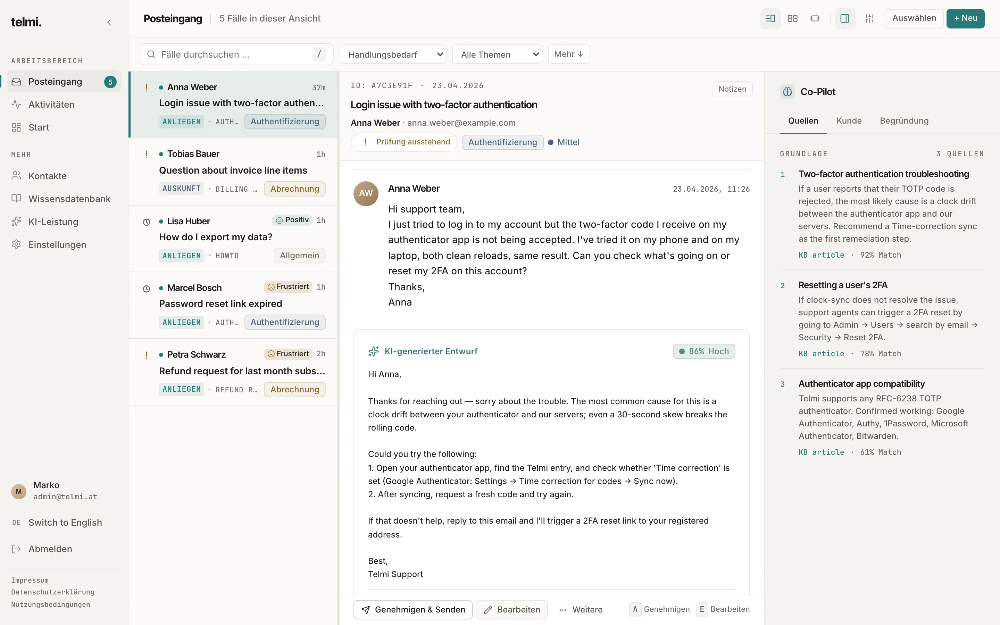
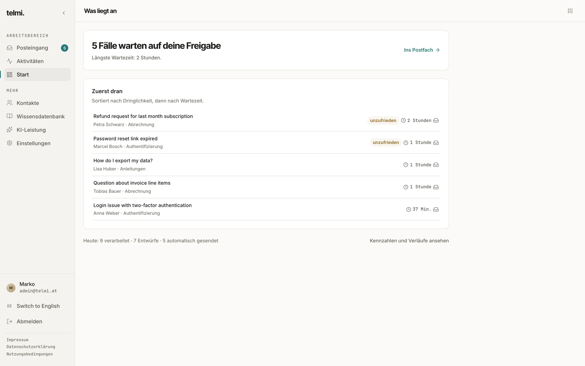
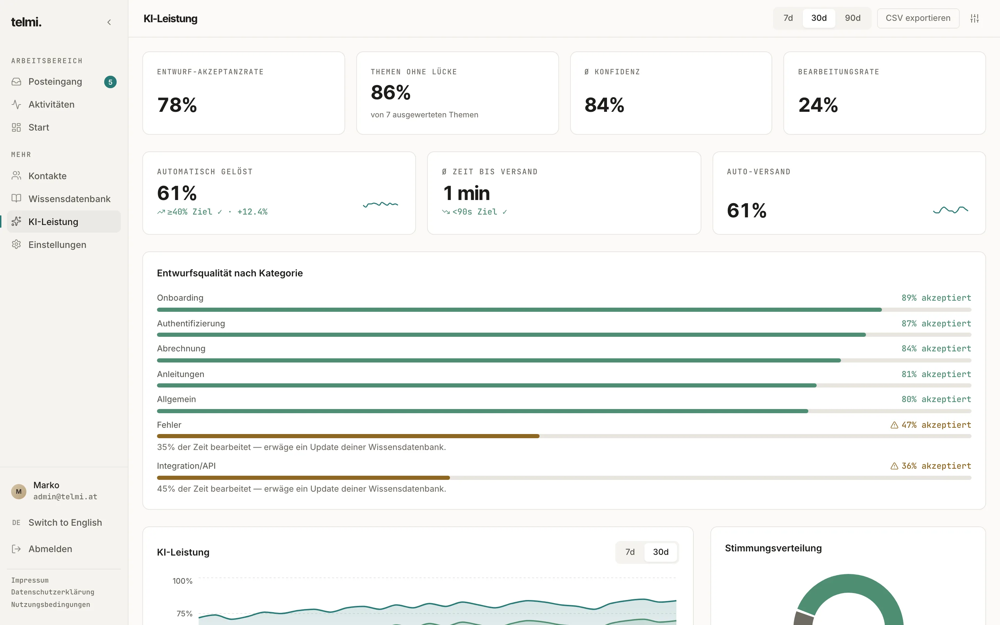
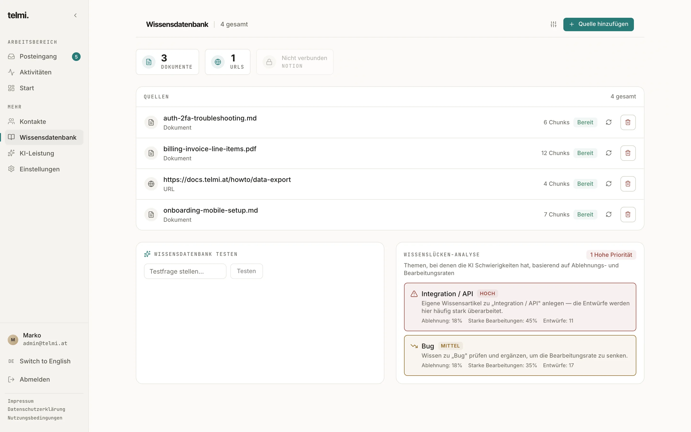
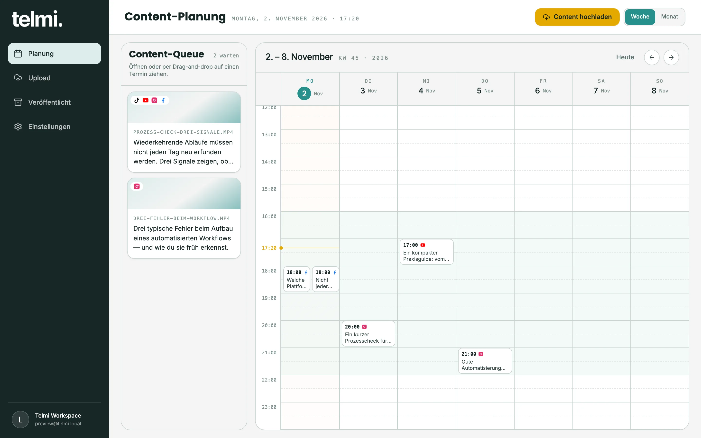
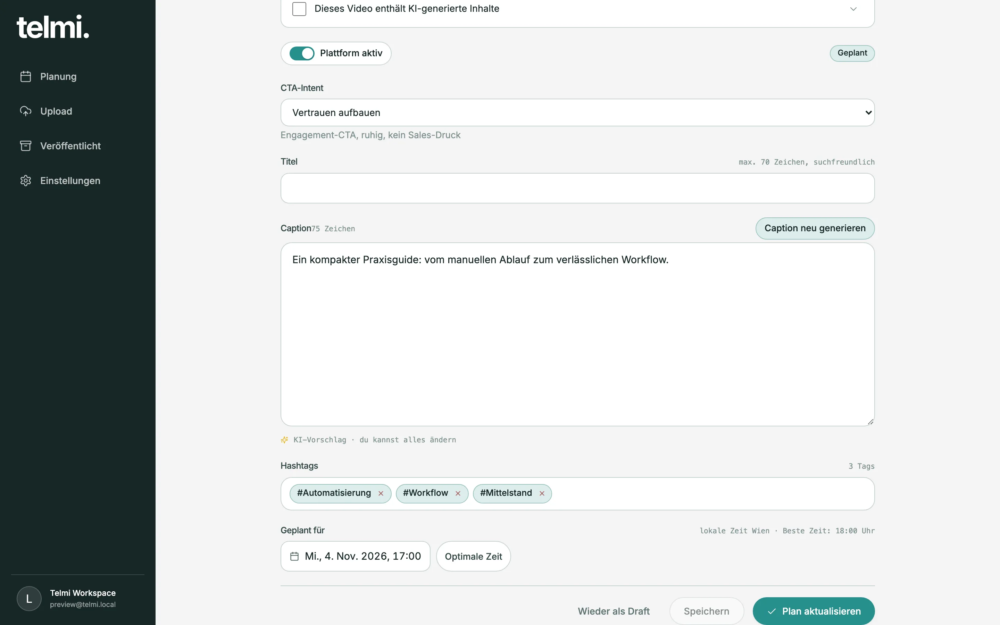
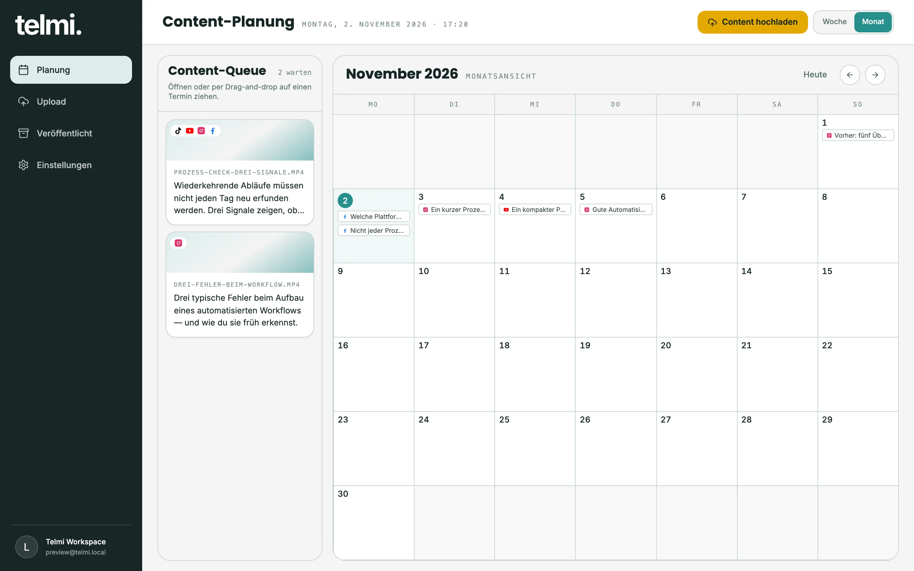
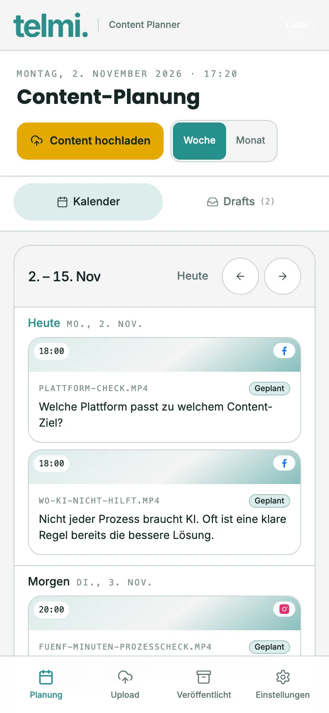

# Project Showcase · Marko Kraljević

Zwei KI-Produkte, die ich allein konzipiert, gestaltet und umgesetzt habe: vom Problem über Datenmodell und Oberfläche bis zu Tests und Betrieb.

**→ [Zur Showcase-Seite](https://markokralj-cloud.github.io/project-showcase/)**

Dieses Repository enthält nur die Präsentation. Der Quellcode beider Produkte ist privat. Durch Architektur, Tests und Entscheidungen führe ich gern in einem Gespräch.

| | Projekt | Worum es geht | Kern |
|---|---|---|---|
| 01 | [AI Inbox](#01--ai-inbox) | KI-Antwortentwürfe für Support-E-Mails, mit Quellen und Freigabe-Workflow | RAG · Klassifizierung · Mehrmandanten-SaaS |
| 02 | [Content Planner](#02--content-planner) | Vom Video zum geplanten Post auf Instagram, Facebook, TikTok und YouTube | Transkription · Caption-Generierung · Scheduling |

---

## 01 · AI Inbox

**Problem.** Support-Postfächer füllen sich mit wiederkehrenden Fragen, deren Antworten längst dokumentiert sind. Vollautomatische Antworten sind aber riskant: Eine falsche oder doppelt verschickte E-Mail kostet mehr Vertrauen, als sie Zeit spart.

**Lösung.** Die KI schreibt den Entwurf und belegt ihn mit Quellen, der Mensch behält die Kontrolle. Pro Kategorie lässt sich festlegen, was geprüft werden muss und was automatisch versendet werden darf.

**Ablauf:** Eingang (IMAP/Webhook) → Klassifizierung → Wissenssuche (RAG über Dokumente, URLs, Notion) → Entwurf mit Konfidenz und Quellen → Freigabe oder Auto-Versand → SMTP-Versand und Auswertung

**Entscheidungen, auf die es ankam**
- **Lieber prüfen als doppelt senden.** Ist unklar, ob eine E-Mail beim Mailserver ankam, wird sie nicht automatisch erneut verschickt.
- **Tickets als Zustandsmaschine.** Definierte Zustände statt widersprüchlicher Sonderfälle.
- **Begründungen müssen stimmen.** Die Oberfläche zeigt den Grund, der tatsächlich gegriffen hat, warum ein Fall beim Menschen liegt.
- **Keine Kundendaten im Monitoring.** Logs werden vor stdout und Sentry auf freigegebene Diagnosefelder reduziert.
- **Invarianten statt Hoffnung.** Ticket-Zustände, Versandgarantie und Mandantentrennung sind festgeschrieben, abgesichert durch knapp 500 automatisierte Tests und visuelle Regressionstests.

**Technik:** TypeScript · React · Vite · Tailwind CSS · Node.js (Express) · PostgreSQL · OpenAI API · Clerk · Stripe · Sentry · Vitest · Playwright

| Start | KI-Leistung | Wissensdatenbank |
|---|---|---|
|  |  |  |

---

## 02 · Content Planner

**Problem.** Ein Video auf vier Plattformen zu bringen heißt: vier Captions, vier Upload-Masken, vier Zeitpläne. Und jede Plattform bestraft andere Fehler mit weniger Reichweite.

**Lösung.** Ein Upload, ein Kalender. Die KI schlägt Caption und Hashtags pro Plattform vor, ein Regelwerk prüft beim Einplanen, und ein Worker veröffentlicht zum geplanten Zeitpunkt.

**Ablauf:** Upload (S3-kompatibel) → Transkript (Whisper) → Caption pro Plattform → Planung im Kalender → Preflight mit 18 Plattformregeln → Veröffentlichung (Meta Graph API für Instagram und Facebook, Publishing-Dienst für TikTok und YouTube)

**Entscheidungen, auf die es ankam**
- **Regeln vor Reichweitenverlust.** Aus den Richtlinien von Meta, TikTok und YouTube abgeleitete Regeln, etwa fremde Wasserzeichen, doppelte Captions oder Clickbait-Titel. Kritische Funde verlangen eine ausdrückliche Bestätigung.
- **Worker getrennt von der Web-App.** Scheduling, Veröffentlichung und Token-Erneuerung laufen unabhängig von der Oberfläche.
- **Fehler, mit denen man etwas anfangen kann.** Fehlschläge werden pro Plattform klassifiziert und mit konkreter Handlungsanweisung angezeigt.
- **Tokens sparen.** Finden sich mindestens drei Hashtags aus dem Pool im Transkript, werden diese übernommen, die KI ergänzt nur bei Bedarf.

**Technik:** TypeScript · Next.js · React · Tailwind CSS · Drizzle ORM · PostgreSQL · Node.js Worker · OpenAI API · Whisper · S3 Storage · Meta Graph API · Clerk

| Editor | Monatsansicht | Mobil |
|---|---|---|
|  |  |  |

---

## Arbeitsweise

Ich entwickle mit KI-Coding-Agents (Claude Code, Codex) nach festen Regeln:

1. **Invarianten.** Regeln, die nie brechen dürfen, stehen im Repository.
2. **Branch.** Ein Branch pro Arbeitspaket.
3. **Checks.** Lint, Typecheck, Build und Tests vor jedem Commit.
4. **Review.** Unabhängiges Review des exakten Stands.
5. **Merge.** Erst wenn alle Nachweise grün sind.

Alle Screenshots zeigen lokale Demo-Umgebungen mit erfundenen Daten. Video- und Bildvorschauen sind Platzhalter.
